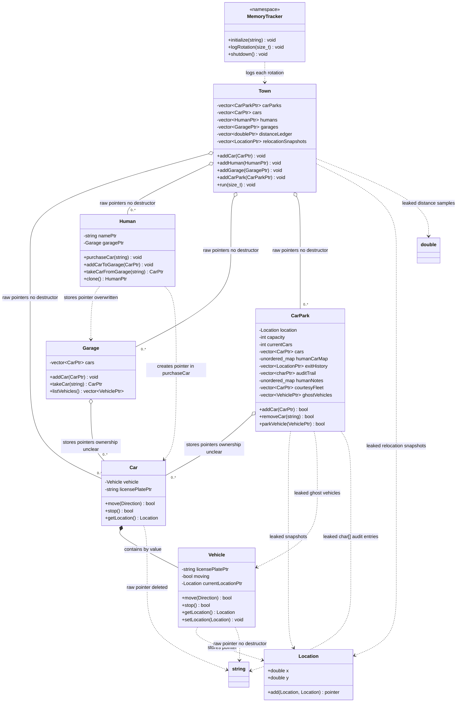

# Town Simulation UML Diagram

This diagram describes the current implementation in `main.cpp`.
It documents the current pointer relationships, including unsafe ownership.

## Relationship Legend

| Diagram notation | Meaning in this program |
|---|---|
| `*--` | Composition or value ownership. `Car` contains a `Vehicle` object directly. |
| `o--` | Collection of raw pointers. The collection stores pointers, but the code does not define safe ownership. |
| `..>` | A pointer or dependency relationship. Ownership must be checked in the source. |
| `owns ... but no destructor` | The object allocates memory but does not release it correctly. |
| `leaked ...` | The program allocates an object and stores the pointer without a cleanup path. |

## Important Ownership Problems Shown

1. `Town`, `Garage`, and `CarPark` all store `Car*` pointers. The same car can appear in multiple collections, but no class clearly owns it.
2. `Vehicle::licensePlate`, `Vehicle::currentLocation`, `Car::licensePlate`, and `Human::name` are raw pointers allocated with `new`.
3. `Vehicle::setLocation(Location)` stores the address of a local parameter, creating a dangling pointer.
4. `Garage::listVehicles()` creates `Vehicle*` and `Location*` objects that are returned without an owner.
5. `CarPark` stores several raw-pointer histories and logs without destructors.
6. `Town` stores the main objects but has no destructor to clean them up.
7. `main()` deletes the last loop variables even though those objects are also stored in `Town`, leaving dangling pointers in the town.
8. `CarPark::parkVehicle(Vehicle*)` tries to cast a `Vehicle*` to `Car*`, although `Car` does not inherit from `Vehicle` in the current design.

## Safer Future Design

A safer redesign would use:

- `Location` and `std::string` as values instead of owning raw pointers.
- `std::unique_ptr` in the class that owns each `Car`, `Human`, `Garage`, and `CarPark`.
- Raw pointers or references only for explicitly non-owning relationships.
- `std::vector<Location>`, `std::vector<double>`, and `std::vector<std::string>` for history and logs.
- A single owner for each `Car` so it cannot be owned simultaneously by `Town`, `Garage`, and `CarPark`.
